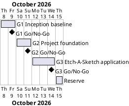

# Project Plan: Etch-A-Sketch

## Metadata
| Key | Value |
| --- | --- |
| ID | PP-001 |
| CrossReference | [BC-001], [SA-001], [MIL-001], [MIL-002], [MIL-003] |
| Language | en |
| Domain | it |

## Version History
| Date | Status | Author | Reviewer | Change | Commit |
| --- | --- | --- | --- | --- | --- |
| 2026-10-08 | Accepted | Jens Tirsvad Nielsen | S01 | Initial version | [5f9d016] |

---

## Purpose

This plan schedules the three gateways of the Etch-A-Sketch project, [MIL-001], [MIL-002] and [MIL-003], over the one-week schedule assumed in the Business Case [BC-001]. It lists each gateway with its window, owner and deliverable; the tasks of each gateway are in its milestone document and become issues on the git host.

## Planning Assumptions

- Week 1 starts on 2026-10-08 (Thursday); the plan ends by 2026-10-15, the one-week schedule in the Assumptions of [BC-001]. The Business Case has no external deadline, so S01 confirms these dates (see Open Issues).
- Gateway length is one to three days. Each gateway ends with a Go/No-Go decision by S01 at the end of the gateway, as the communication cadence of [SA-001] says.
- Each gateway is one branch and one pull request: `g1-inception-baseline`, `g2-project-foundation` and `g3-etch-a-sketch-application`. The pull request closes the issues of its gateway, one `Closes #N` line each. A reviewer other than the author merges; nobody merges on S01's behalf.
- S01 is the author, developer and reviewer of every document (conflict 1 in [SA-001]). The plan accepts this for a single-person project and relies on the quality control (QC) checklists, the review records and the pull request as the checks.
- No use case or user story is modelled. The behaviour of the application is five key bindings, specified by objectives O1 and O2 of [BC-001], so every task is a plain technical task (the milestone column *Needs its own Use Case/User Story?* says `No`).

## Gateway Schedule

| Gateway | Document | Window | Decision date | Owner | Stories | Main deliverable | Milestone |
| --- | --- | --- | --- | --- | --- | --- | --- |
| G1 Inception baseline | [MIL-001] | 2026-10-08 to 2026-10-09 | 2026-10-09 | S01 | none | Accepted Business Case, Stakeholder Analysis, Project Plan and milestones; issues on the git host; repository description and topics | [Milestone 75][M75] |
| G2 Project foundation | [MIL-002] | 2026-10-10 to 2026-10-11 | 2026-10-11 | S01 | none | `pyproject.toml`, `.gitignore`, `Doxyfile`, `README.md`, continuous integration workflow and a verified local `.venv` | [Milestone 76][M76] |
| G3 Etch-A-Sketch application | [MIL-003] | 2026-10-12 to 2026-10-14 | 2026-10-14 | S01 | none | The tested and documented application with five keyboard controls and a code review with the verdict Go | [Milestone 77][M77] |



## Scope Coverage

| Business Case scope item | Gateway |
| --- | --- |
| Planning documents under `docs/`, milestones and issues on the git host | G1 |
| Repository description and topics on the git host | G1 |
| `pyproject.toml` (Python 3.13 or newer, no runtime dependencies) | G2 |
| Python `.gitignore` and `Doxyfile` | G2 |
| Continuous integration workflow definition | G2 |
| `README.md` using S01's template, including the local `.venv` instructions | G2 (written), G3 (completed) |
| Package skeleton and smoke test | G2 |
| `constants.py` | G3 |
| The five control functions, the key bindings and the entry point | G3 |
| pytest tests of the controls | G3 |
| Doxygen comments in the source | G3 |

## Dependencies

```
G1 Inception baseline → G2 Project foundation → G3 Etch-A-Sketch application
```

A gateway starts after the Go of the one before it, because the plan-first gate allows files under `src/` and `tests/` only after the baseline is accepted. A No-Go moves the later windows by the days needed for rework; the reserve day on 2026-10-15 absorbs one day, and any further delay needs a new end date confirmed by S01.

## Plan Risks

| Risk | Impact | Mitigation |
| --- | --- | --- |
| A reviewer to merge a pull request is not available | The next gateway waits | The schedule counts the Go decision, not the merge; the next branch starts from `main` after the merge, or from the previous branch while the merge is pending |
| The git host has no continuous integration runner | The workflow definition cannot be proven on the host | The same commands run locally in G2 and the output is recorded in the review |
| The one-week schedule is a guess | The end date slips | One reserve day; S01 confirms or changes the dates before G1 is accepted |
| Review of own work misses defects | A defect reaches the pull request | The quality control (QC) checklists are transcribed row by row with evidence, and the pull request is read by a second person before the merge |

## Open Issues

- **Dates:** the start (2026-10-08) and the one-week end (2026-10-15) are assumed. S01 confirms them.
- **Python version:** "Python greater than 3.13" is read as 3.13 or newer (`requires-python = ">=3.13"`). If it must mean 3.14 or newer, the Python installed on S01's machine (3.13.14) does not meet it. S01 confirms.
- **User stories:** none are modelled (see Planning Assumptions). If S01 wants them, `US-001` is written before the tasks of G3 and the milestone rows get a reference to it.
- **README template:** S01's template (*Set up*, *Run the tests*, *Continuous integration*, *Build the source documentation*, *Project layout*) differs from `framework/templates/README-template.md` in section names and order. The project follows S01's template; the opt-in `check-readme.sh` would report the differences if it were enabled. S01 confirms.
- **Missing artifact types:** there is no Domain Dictionary, Governance document, Traceability Matrix or KPI document, and `PP` has no QC checklist yet. The review records mark the criteria that depend on them `N-A` with this note, unless S01 asks for them to be added.
- **Starter archive:** `etch-a-sketch-start.zip` in the repository root is course material, not a deliverable. S01 decides whether to delete it or ignore it before the first commit.
- **Plan-gate hook:** `bash framework/scripts/install-git-hooks.sh --enable-plan-gate` would enforce the gate at commit time. It changes the local git configuration, so S01 decides.
- **Milestone links:** the *Milestone* column above stays empty until `sync-project.sh --apply` has created the milestones on the git host.

---

[BC-001]: ./business-case.md
[SA-001]: ./stakeholder-analysis.md
[MIL-001]: ./milestones/mil-001-g1-inception-baseline.md
[MIL-002]: ./milestones/mil-002-g2-project-foundation.md
[MIL-003]: ./milestones/mil-003-g3-etch-a-sketch-application.md
[M75]: https://git.tirsystem.com/Tirsvad-Udemy-100-days-of-code/019-etch-a-sketch-up/milestone/75
[M76]: https://git.tirsystem.com/Tirsvad-Udemy-100-days-of-code/019-etch-a-sketch-up/milestone/76
[M77]: https://git.tirsystem.com/Tirsvad-Udemy-100-days-of-code/019-etch-a-sketch-up/milestone/77
[5f9d016]: https://git.tirsystem.com/Tirsvad-Udemy-100-days-of-code/019-etch-a-sketch-up/commit/5f9d01636b37ac71e4d3d35374864a091c7d6f10
